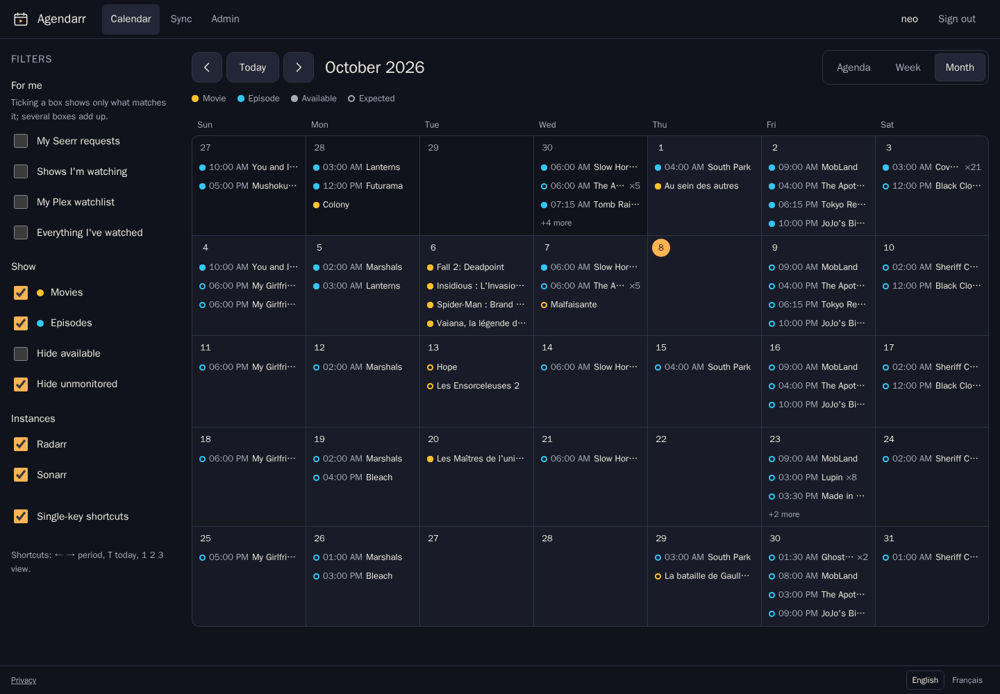
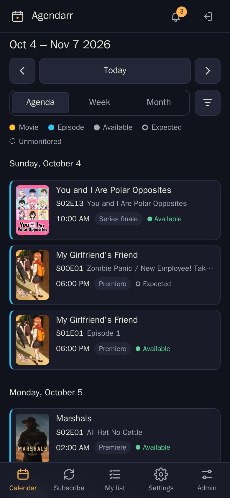
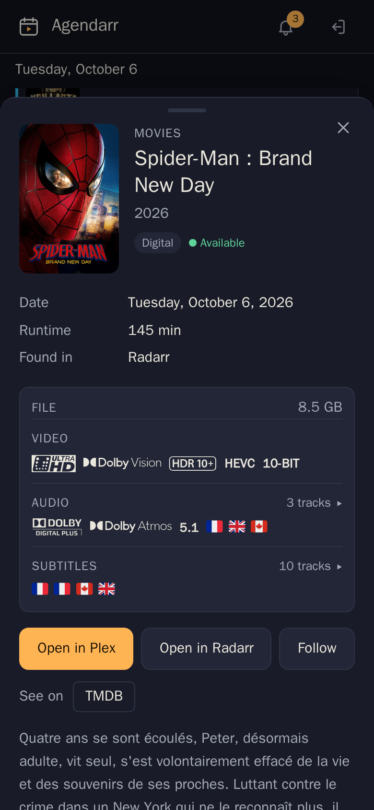
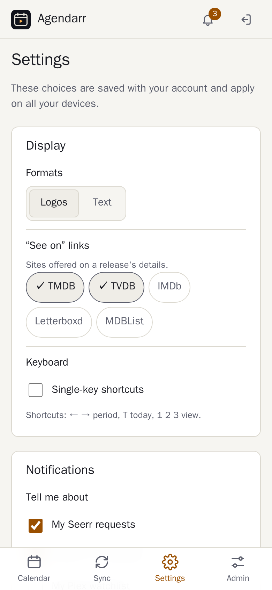
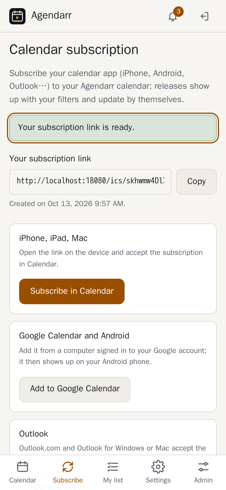
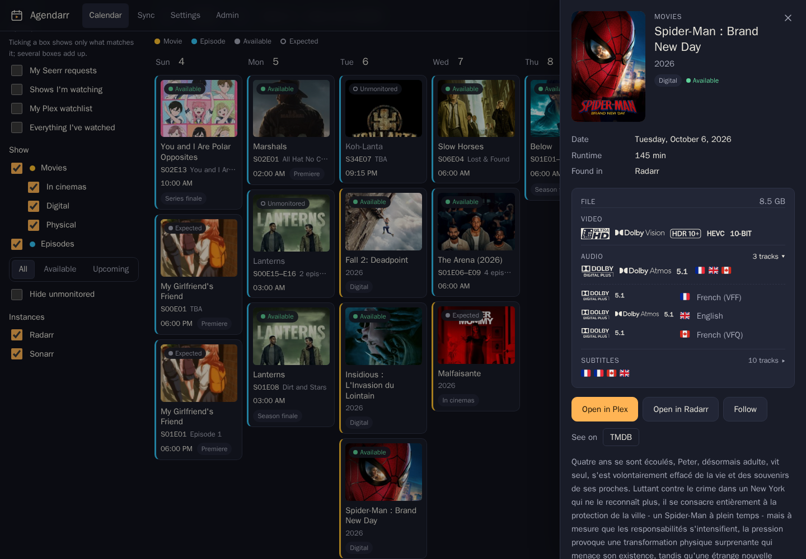
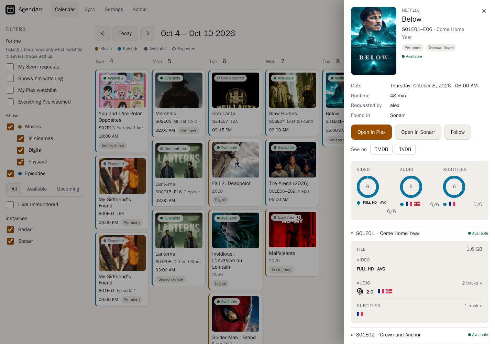
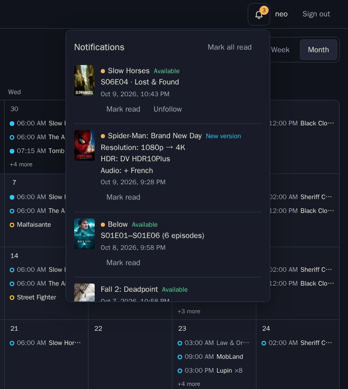
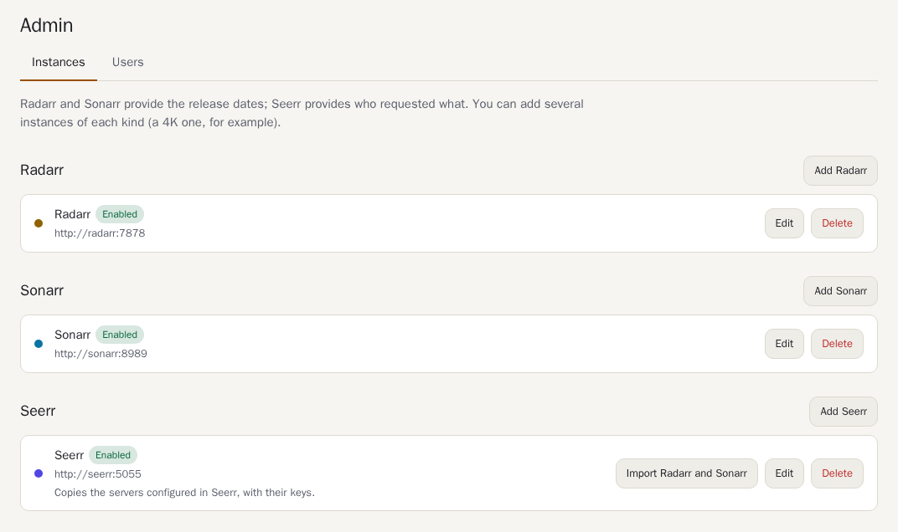

<div align="center">


# Agendarr

**The release calendar for your Plex household.**

Radarr, Sonarr and Seerr in one calendar. Everyone signs in with their Plex account,
sees what's coming or just what they care about, and gets told when it lands.

[](https://github.com/neotoxicfr/agendarr/actions/workflows/ci.yml)
[](https://github.com/neotoxicfr/agendarr/releases)
[](LICENSE)

</div>

<picture>
  <source media="(prefers-color-scheme: light)" srcset="docs/screenshots/desktop-month-light.png">
  
</picture>

## Why Agendarr

Radarr and Sonarr each have a calendar, but each one only covers its own instance,
and only the admin can open them. Agendarr gives the whole household one calendar:

- **Nothing to set up for your users.** Anyone you share your Plex server with
  signs in with Plex. No accounts or invitations to create.
- **Everyone gets their own view.** *My Seerr requests*, *shows I'm watching*,
  *my Plex watchlist*, *everything I've watched*: each person ticks what they want.
- **It goes where people already look.** A personal iCal link puts releases in
  Apple Calendar, Google Calendar or Outlook, with that person's filters applied,
  and a notification arrives when something they asked for is ready to watch.

<table>
  <tr>
    <td width="25%"></td>
    <td width="25%"></td>
    <td width="25%"></td>
    <td width="25%"></td>
  </tr>
  <tr>
    <td align="center">Agenda on a phone</td>
    <td align="center">What's in the file</td>
    <td align="center">Settings</td>
    <td align="center">Subscribe in your calendar</td>
  </tr>
</table>



<table>
  <tr>
    <td width="62%"></td>
    <td width="38%"></td>
  </tr>
  <tr>
    <td align="center">A whole season at a glance</td>
    <td align="center">Notifications</td>
  </tr>
</table>

## Features

- **Every instance in one place.** Add as many Radarr and Sonarr instances as you
  run (4K, anime…); a release seen by several of them shows once. Movies show
  their cinema, digital and physical releases, which you can narrow down.
  Episodes show their air time in each viewer's time zone, and premieres and
  finales are flagged.
- **Plex sign-in.** On first run, the owner of the Plex server becomes the
  administrator and their server is bound automatically. Access is re-checked
  every day, so someone you stop sharing with loses access too.
- **What's in the file, before you press play.** An available release shows the
  formats Plex found in the file itself, as official logos or plain text: 4K,
  Dolby Vision, HDR10+, HEVC, Dolby Atmos, DTS-HD MA… Every audio and subtitle
  track is listed with its language as a flag and its title (forced, SDH…).
  A season released at once shows how its episodes split, and each episode
  unfolds its own file.
- **One click away.** Open a release in Plex; administrators also get Radarr or
  Sonarr. *See on* links to TMDB, TVDB, IMDb, Letterboxd or MDBList, each
  person picking the ones they use.
- **Notifications.** Be told when something you requested in Seerr, are
  watching in Plex, or turned on **Notify me** for from its detail sheet becomes
  available, or when its file is upgraded (*Resolution: 1080p → 4K*, *Audio: +
  French*). Each person picks what is worth a notification: availability,
  quality, audio or subtitle changes. Changes show with the same logos as the
  detail sheet. A bell keeps the latest; a notifications page has them all, to
  search, filter, sort, mark read and delete one by one or in bulk. With Web
  Push, notifications reach your phone or computer even with Agendarr closed.
- **My list.** Everything you will be notified about in one page, each title
  marked by where it comes from (Seerr request, Plex, or set by hand), with
  search, filters and sorting; alerts set by hand are removed from there.
- **Personal filters**, which can be combined: Seerr requests, shows watched in
  the last 90 days, Plex watchlist, full Plex history. Every release shows who
  requested it.
- **Made for desktop and phone alike.** On desktop: month, week and agenda views,
  keyboard shortcuts and a filter panel. On phones: a bottom tab bar, swipe
  between periods and bottom sheets. Installable as an app (PWA) and readable
  offline.
- **Calendar subscription.** A private iCal link per person, which they can revoke
  at any time.
- **Accessible.** Checked against WCAG 2.2 AA with axe on every page. Fully
  usable with a keyboard, labelled for screen readers, and it respects reduced
  motion.
- **Light and dark**, following the system theme. **English and French**, taken
  from the browser or picked in the footer.
- **Small and private.** A single Go binary in a distroless image (amd64, arm64,
  armv7) and one SQLite file. API keys never reach the browser, and the server
  only talks to your own servers, plex.tv and, for notifications people turn on,
  their browser's push service.

## Requirements

- A **Plex Media Server**. You sign in with the account that owns it.
- **Radarr** and/or **Sonarr** (API v3; tested with Radarr 6 and Sonarr 4).
- Optional: **Seerr** (or Overseerr / Jellyseerr) for the *my requests* filter,
  the *requested by* names and notifications about requests.
- A reverse proxy with **HTTPS** if you want the app to install on phones,
  calendar apps to subscribe and notifications to reach devices.

## Quick start

```yaml
# docker-compose.yml
services:
  agendarr:
    image: ghcr.io/neotoxicfr/agendarr:latest
    container_name: agendarr
    restart: unless-stopped
    environment:
      TZ: Europe/Paris
      AGENDARR_BASE_URL: https://agenda.example.com
      # Optional: how Agendarr reaches Plex for the history-based filters.
      # AGENDARR_PLEX_SERVER_URL: http://plex:32400
    volumes:
      - ./data:/data
    ports:
      - "8080:8080"
    read_only: true
    cap_drop: [ALL]
    security_opt:
      - no-new-privileges:true
```

```bash
docker compose up -d
```

Then open `https://agenda.example.com`. [`deploy/compose.yml.example`](deploy/compose.yml.example)
has the same file with comments.

### First run

1. **Sign in with the Plex account that owns the server.** It becomes the
   administrator. If it owns several servers, pick one. Do this right after
   starting the container, before sharing the URL: until then, the first
   person to sign in with a Plex server of their own becomes the administrator.
2. In **Admin › Instances**, add **Seerr**, then click **Import Radarr and Sonarr**:
   Agendarr copies the servers Seerr already knows, API keys included. You can
   also add Radarr and Sonarr by hand (the API key is in *Settings › General* of
   each app). **Test connection** checks each one before saving.
3. Optional: give each Radarr and Sonarr instance its **public address**
   (e.g. `https://radarr.example.com`) so administrators get *Open in Radarr /
   Sonarr* links. *Import Radarr and Sonarr* fills it from Seerr when it knows it.
4. **Share the URL** with your Plex users. They sign in with Plex, and that's it.
   Each person picks their display and notification choices in **Settings**.

<p align="center">
  
</p>

### Behind a reverse proxy

Agendarr is a plain HTTP server on port 8080. Leave compression to the proxy.

<details>
<summary>Caddy</summary>

```caddy
agenda.example.com {
    encode zstd gzip
    reverse_proxy agendarr:8080
}
```
</details>

<details>
<summary>Traefik (labels)</summary>

```yaml
    labels:
      traefik.enable: "true"
      traefik.http.routers.agendarr.rule: Host(`agenda.example.com`)
      traefik.http.routers.agendarr.entrypoints: websecure
      traefik.http.routers.agendarr.tls.certresolver: letsencrypt
      traefik.http.services.agendarr.loadbalancer.server.port: "8080"
```
</details>

<details>
<summary>nginx</summary>

```nginx
server {
    listen 443 ssl;
    server_name agenda.example.com;
    # ssl_certificate …

    location / {
        proxy_pass http://agendarr:8080;
        proxy_set_header Host $host;
        proxy_set_header X-Forwarded-Proto $scheme;
    }
}
```
</details>

Calendar apps fetch the iCal link from their own servers, so don't put an IP
allowlist in front of `/ics/`, or Google and Outlook won't be able to read it.
Agendarr itself needs outbound HTTPS to plex.tv and, for Web Push, to the
browsers' push services (Google, Mozilla, Apple, Microsoft).

## Configuration

Everything else is set up in the app. The environment only covers what the
app can't work out by itself:

| Variable | Default | Purpose |
| --- | --- | --- |
| `AGENDARR_BASE_URL` | derived from requests | Public URL, used for the Plex sign-in return, iCal links and as the contact push services see. Set it behind a proxy. |
| `AGENDARR_PLEX_SERVER_URL` | addresses advertised by plex.tv | How Agendarr reaches Plex for the history-based filters, file formats, tracks and *Open in Plex* links, e.g. `http://plex:32400` on a shared Docker network |
| `AGENDARR_LISTEN` | `:8080` | HTTP listen address |
| `AGENDARR_DATA_DIR` | `/data` | Database, encryption key, poster cache |
| `AGENDARR_SECURE_COOKIES` | `true` when the base URL is https | Force the `Secure` cookie flag on or off |
| `TZ` | UTC | Server time zone (logs). Each viewer sees times in their own time zone. |

## Updating and backups

```bash
docker compose pull && docker compose up -d
```

Database migrations run on start. To back up, copy the data volume while the
container is stopped. Keep `secret.key` with `agendarr.db`: tokens, API keys
and the Web Push key are encrypted with it, and a database without its key
can't be read (people would have to turn notifications on again).

## Troubleshooting

- **"Shows I'm watching" or "Everything I've watched" says Plex is unreachable.**
  Agendarr reads the history on your Plex server itself. Set
  `AGENDARR_PLEX_SERVER_URL` to an address the container can reach, such as
  `http://plex:32400`.
- **"My Seerr requests" says no account is linked.** The person has never signed
  in to Seerr with Plex, so Seerr doesn't know them.
- **Google Calendar shows nothing yet.** Google refreshes subscribed calendars
  every 12 to 24 hours. Apple and Outlook refresh about every hour.
- **The app doesn't offer to install.** Installing requires HTTPS.
- **No *Open in Plex* button, no tracks.** The release is not in your Plex
  library, or Agendarr cannot reach the Plex server: see
  `AGENDARR_PLEX_SERVER_URL`. The library is indexed at startup and every 30
  minutes, so a file added a moment ago may take that long.
- **Notifications don't reach a device.** Turn on *Notifications on this
  device* in Settings on that device and allow them when the browser asks. On
  iPhone and iPad, add Agendarr to the home screen first (Safari only allows
  notifications for installed apps). In-app, the bell works everywhere.

## How it works

- Radarr and Sonarr calendars are read with their API keys and cached per month
  for five minutes. An unreachable instance keeps its last known dates and is
  named in a warning. Posters go through Agendarr, so API keys never reach the
  browser.
- Seerr requests are indexed every ten minutes. Plex history is read from your
  server with the owner's token and resolved to TMDB/TVDB/IMDb ids once. The
  Plex library is indexed by those ids every 30 minutes; a detail sheet then
  asks Plex for that item's file and tracks.
- *My list* matches each person's Seerr requests, Plex shows and alerts with the
  Radarr and Sonarr libraries (read every 30 minutes) for titles, posters and
  next release dates.
- Every five minutes a watcher compares each release's file (from a month back
  to two weeks ahead) with the one it saw before: a file that appears is
  *available*, one that changes on the same instance is a *new version*. It
  never waits on Plex or Seerr; what it cannot match yet is retried.
- Notifications are encrypted for each browser (RFC 8291) and signed with the
  server's own key (VAPID, RFC 8292), using Go's standard library only. Only
  the browsers' push services are accepted as destinations.
- Everything lives in one SQLite file. Plex tokens and API keys are encrypted
  with AES-256-GCM. See [SECURITY.md](SECURITY.md) and the in-app privacy page.

## Development

Requires Go (see [`go.mod`](go.mod)).

```bash
make dev         # http://localhost:8080, data in ./data
make test-race
make lint
```

Contributions are welcome: see [CONTRIBUTING.md](CONTRIBUTING.md). Report
security issues privately as described in [SECURITY.md](SECURITY.md).

## License

[MIT](LICENSE). Country flags come from [Twemoji](https://github.com/twitter/twemoji)
(CC-BY 4.0) through [country-flag-emoji-polyfill](https://github.com/talkjs/country-flag-emoji-polyfill)
(MIT), see [`web/static/fonts`](web/static/fonts/LICENSE.md). Format logos (Dolby, DTS,
HDR10) come from Wikimedia Commons and remain trademarks of their owners, see
[`web/static/logos`](web/static/logos/LICENSE.md).
