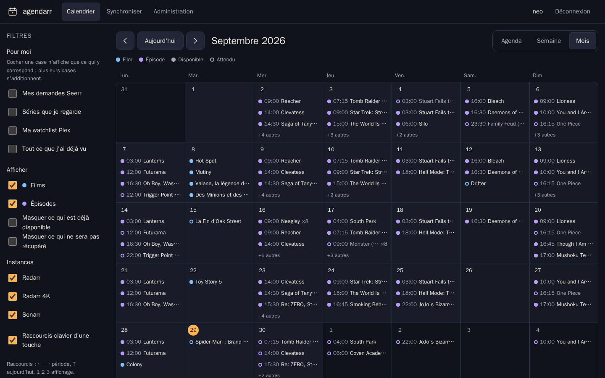

# Agendarr

A self-hosted release calendar for a Plex household. Agendarr merges the
calendars of your Radarr and Sonarr instances, knows from Seerr who asked for
what, and lets each person sign in with their Plex account to see everything —
or only what concerns them.



| Week view | Agenda on a phone | Release details |
| --- | --- | --- |
|  |  |  |

## Features

- **One calendar for every instance**: several Radarr and Sonarr instances
  (a 4K one, an anime one…), duplicates merged. Movies show their cinema,
  digital and physical releases; episodes their exact air time, in each
  viewer's time zone.
- **Sign in with Plex**: anyone the Plex server is shared with can sign in.
  On first run, the owner of the Plex server becomes the administrator and
  the server is bound automatically. Access is re-checked daily.
- **Personal filters**, each person's choice, combinable: *my Seerr
  requests*, *shows I'm watching* (Plex history, last 90 days), *my Plex
  watchlist*, *everything I've watched*. Every release shows who requested it.
- **Desktop and phone alike**: month, week and agenda views; keyboard
  shortcuts and a side panel on desktop; bottom tab bar, swipe and bottom
  sheets on phones. Installable as a PWA, readable offline.
- **Calendar subscription**: a personal iCal link for Apple Calendar, Google
  Calendar (and so Android) and Outlook, with your filters applied.
- **Accessible**: WCAG 2.2 AA checked with axe on every page, full keyboard
  use, screen-reader labels, reduced motion respected.
- **French and English**, picked from the browser or chosen in the footer.

## Install

```yaml
services:
  agendarr:
    image: ghcr.io/neotoxicfr/agendarr:latest
    container_name: agendarr
    restart: unless-stopped
    environment:
      TZ: Europe/Paris
      AGENDARR_BASE_URL: https://agenda.example.com
    volumes:
      - ./data:/data
    ports:
      - "8080:8080"
    read_only: true
    cap_drop: [ALL]
    security_opt:
      - no-new-privileges:true
```

The full example is [`deploy/compose.yml.example`](deploy/compose.yml.example).
Put Agendarr behind your reverse proxy over HTTPS: the PWA only installs over
HTTPS, and calendar apps need a public URL to subscribe.

### First run

1. Open Agendarr and **sign in with the Plex account that owns the server**.
   It becomes the administrator; if it owns several servers, pick one.
2. In *Admin › Instances*, add **Seerr**, then click **Import Radarr and
   Sonarr**: Agendarr copies the servers Seerr knows, keys included. Or add
   Radarr and Sonarr by hand (*Settings › General* in each app for the API
   key). **Test connection** checks each one before saving.
3. Share the URL with your Plex users: they sign in with Plex, nothing to
   create.

## Configuration

| Variable | Default | Purpose |
| --- | --- | --- |
| `AGENDARR_LISTEN` | `:8080` | HTTP listen address |
| `AGENDARR_DATA_DIR` | `/data` (image), `./data` | Database, encryption key, poster cache |
| `AGENDARR_BASE_URL` | derived from requests | Public URL, used for the Plex sign-in return and iCal links. Set it behind a proxy. |
| `AGENDARR_PLEX_SERVER_URL` | advertised connections | How Agendarr reaches Plex for the history-based filters, e.g. `http://plex:32400` on a shared Docker network |
| `AGENDARR_SECURE_COOKIES` | `true` when the base URL is https | Force the `Secure` cookie flag |

## How it works

- Radarr and Sonarr calendars are read with their API keys and cached per
  month for five minutes; an unreachable instance keeps its last known dates
  and is named in a warning. Posters go through Agendarr
  (`/api/v3/mediacover`), so API keys never reach the browser.
- Seerr requests are indexed every ten minutes. Plex history is read on your
  server with the owner's token and resolved to TMDB/TVDB/IMDb ids once.
- Everything lives in one SQLite file. Plex tokens and API keys are encrypted
  with AES-256-GCM; the key sits next to the database, so keep the data
  volume private. See [SECURITY.md](SECURITY.md) and the in-app privacy page.

## Development

```bash
make dev         # http://localhost:8080, data in ./data
make test-race
make lint
```

See [CONTRIBUTING.md](CONTRIBUTING.md). Security issues: [SECURITY.md](SECURITY.md).

## License

[MIT](LICENSE)
